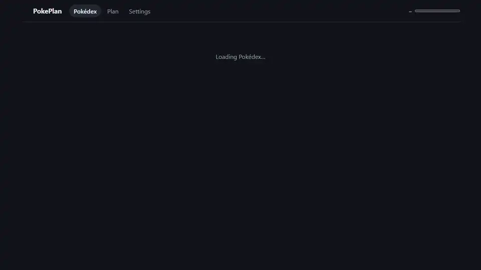

# PokePlan – Let's catch them all

**➡️ [pokeplan.albertowd.dev](https://pokeplan.albertowd.dev)**

PokePlan tracks your **Pokémon HOME** National Pokédex and tells you, for every Pokémon you're missing, **which game, DLC, app or event has it**, **how to get it into HOME**, and **which games to play or buy next**.

| Desktop | Mobile |
|:---:|:---:|
|  |  |

## Features

### Your HOME Pokédex at a glance

All 1,025 species, with a progress bar for how many you've registered. Tap **+** on a card to mark a Pokémon as registered in HOME, and filter the list to show only what's **missing**.

### Where to find each Pokémon

Open any Pokémon to see every source that has it today:

- **specific games and DLC**, not just generations, from Scarlet/Violet and its DLC to Legends: Z-A, Mega Dimension, Legends: Arceus, BDSP, Sword/Shield and its DLC, Let's Go and FireRed/LeafGreen on Switch;
- **version exclusives**, e.g. "Scarlet only" or "Shield only";
- **how** you get it, when known: catch, evolve, gift, raid, or "past event only";
- **Pokémon GO** and **HOME rewards** (e.g. Magearna for completing the National Pokédex);
- **retro games** (3DS, DS, GBA), shown on request.

### The best way into HOME

For every source, PokePlan explains how the Pokémon reaches HOME and what to watch out for, and it highlights the best option, preferring games you own:

- **two-way** games, where you can move the Pokémon back later;
- **one-way** games and apps (Let's Go, FireRed/LeafGreen, GO), where it can never go back;
- the **Legends: Z-A lock**: anything caught in or moved into Z-A can never go to older games;
- **Pokémon Bank**, for 3DS and older games, until it shuts down on 25 February 2027.

### Filters that combine

Search by name or number, and tick **several games and DLC at once** (each DLC sits under its game), several generations, and registered or missing. For example: "what's still missing that Scarlet/Violet and both DLC can give me?"

### A plan for what to play next

The **Plan** lists your missing Pokémon by source: first the games you own, then, one at a time, the game or DLC that unlocks the most of what's left. A DLC is only suggested once its base game is in the plan. Anything only available from past events is listed separately.

### Built for real collections

- **Mark everything** and untick what's missing, if you only have a few left to catch.
- **Paste a list** of numbers or names to mark them all at once.
- **Back up and restore** your progress as a file, to move it to another device.
- No account needed: your progress is saved **in your browser**.

### Sync across devices (optional)

Tap the trainer in the header to sign in with Google and keep your progress and owned games in sync on your phone, tablet and computer. Once signed in, the header shows your name, with a menu to sign out. The first time you sign in on a device, its progress is merged with your account, so nothing is lost.

Changes are saved about 30 seconds after your last edit, so ticking through the list costs one save instead of dozens. The header shows when the next save happens, with a **Save now** button. If you try to close the page with changes waiting, your browser asks you to confirm. If it closes anyway, the changes are kept on the device and saved on your next visit.

PokePlan stores only your Google account id, name and email (for sign-in) and your progress. **Settings → Delete cloud data and account** removes both; your progress stays on the device.

### English and Português (Brasil)

PokePlan follows your browser's language, and you can switch it with the flag in the header. The whole app is translated, including game names, HOME transfer instructions and notes on each source. Pokémon names and official game titles stay as sold in Brazil.

### Install it, use it offline

PokePlan is a Progressive Web App. Install it from your browser to your phone or desktop, and it keeps working **offline** once loaded. It adapts to phone screens and follows your system's light or dark theme.

## How Pokémon HOME works (as modelled here)

- HOME registers a Pokémon in its National Pokédex **when it is deposited in a HOME box**. Pokémon received in HOME trades count too.
- **FireRed/LeafGreen (Switch)** is the only game whose own Pokédex syncs to HOME. Each transfer syncs it, so species registered in FRLG count toward HOME's FRLG dex without moving each one. It is not confirmed that this also fills the National Pokédex.
- **Two-way:** Sword/Shield, BDSP, Legends: Arceus, Scarlet/Violet, Legends: Z-A (with the Z-A lock above).
- **One-way:** Let's Go, FireRed/LeafGreen (Switch), Pokémon GO, Pokémon Bank.
- **Pokémon Champions** only borrows Pokémon from HOME, and Pokémon obtained there can't be deposited, so it isn't listed as a source.

### Why there's no automatic HOME sync

Pokémon HOME has no public API, export or share feature for your Pokédex or boxes. The only unofficial route is reading game saves from modded hardware, which breaks the terms of service. That's why PokePlan uses manual tracking, with the shortcuts above to make it quick.

## About the data

Species and per-game Pokédexes come from [PokeAPI](https://pokeapi.co). Version exclusives, special areas, HOME rules, Pokémon GO availability and HOME rewards are curated from Serebii, the official HOME site and guides.

Known limits:

- Availability is per **species**. Regional forms, Megas and Gigantamax forms aren't tracked separately.
- For Scarlet/Violet, Legends: Arceus and Z-A, the data says a species is in the game but not always how you get it.
- Pokémon GO availability rotates with events, so a Pokémon listed for GO may not be catchable today.

Spotted a mistake? Corrections with a source are very welcome.

## Contributing

Bug reports, data corrections and pull requests are welcome. [CONTRIBUTING.md](CONTRIBUTING.md) covers running the project locally, how the data is built, the tests and quality checks, and deployment.

## License

PokePlan is free software: you can redistribute it and/or modify it under the terms of the [GNU Affero General Public License v3.0](LICENSE) or (at your option) any later version.

If you run a modified version where others can use it over a network, the AGPL requires you to offer them its complete source code under the same license.

## Credits and disclaimer

PokePlan is an unofficial, non-commercial fan project. It is not affiliated with, endorsed or sponsored by Nintendo, Creatures, GAME FREAK or The Pokémon Company. Pokémon and Pokémon character names are trademarks of Nintendo. Pokémon images are © Nintendo, Creatures and GAME FREAK; they are not part of this repository and not covered by its license. The app loads them at runtime: Pokémon sprites from the [PokeAPI sprites](https://github.com/PokeAPI/sprites) repository, and the FireRed/LeafGreen trainer sprite in the header from [Pokémon Showdown](https://play.pokemonshowdown.com).
